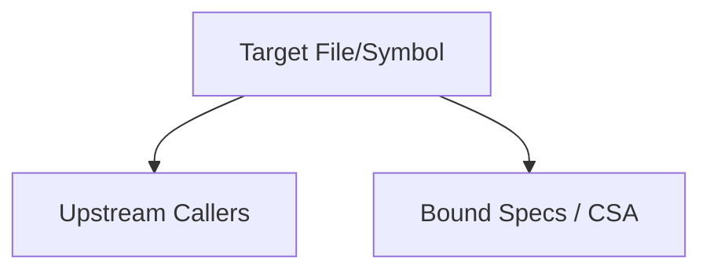

# Graph Impact Analysis Report: [Phase Name / Target Entity]

> **Project:** [Project Name] | **Plan Path:** [Plan Path / Target Entity]  
> **Phase:** [Phase Number / Name] | **Generated:** [Date]  
> **Mode:** [🟢 Full Graph / 🟡 Stale Graph / 🟠 Partial Graph Drift / 🔴 Pure Static]  
> **Risk Score:** [Score/25] | **Level:** [🟢 Low / 🟡 Medium / 🟠 High / 🔴 Critical]  
> **Removal Verdict:** [🔴 SYSTEM WILL BREAK / 🟡 CONDITIONAL REMOVAL / 🟢 SAFE TO REMOVE]

---

## 🎯 Phase & Target Overview
- **Goal / Purpose:** [Brief summary of the phase objective or target entity]
- **Target Files & Symbols:**
  - [List of files / symbols slated for modification in the plan]

## 🗺️ Blast Radius & Dependency Mapping

### [Source File / Symbol Path]
- **Node Type:** [file | function | class]
- **Direct Upstream Callers (Immediate Blast Radius):**
  - [Immediate callers]
- **Transitive Upstream Callers (Extended Blast Radius):**
  - [Transitive callers]
- **Downstream Dependencies (Callees):**
  - [What this file calls or imports]
- **Linked Specs (CSA Anchors):**
  - [Bound specs or micro-anchors]
- **Risk Assessment:** [🟢 Low | 🟡 Medium | 🔴 Critical] - [Explanation of potential side-effects]

## 📊 Dependency Graph (Mermaid)

## ⚠️ Ecosystem Risks & Structural Safeguards
- **God Nodes Affected:** [Yes/No - List affected God Nodes and connection degree]
- **Security Contexts Touched:** [Yes/No - e.g., auth, cookies, CORS, API gates]
- **Data Flow Risks:** [Yes/No - database transactions, cache invalidations]

## 🚀 Safe Migration Order
1. Step 1: Update Type Interfaces (`src/types.ts`)
2. Step 2: Refactor Target Implementation
3. Step 3: Refactor Callers in Order of Dependency
4. Step 4: Update Specs & Run CSA Audit (`/para-graph audit-csa`)
5. Step 5: Run Regression Tests (`npm test`)

## 💡 Plan Amendment Recommendations
- **Scope Alignment:** [Does the blast radius match the declared plan scope? Yes/No]
- **Recommended Plan Changes:**
  - [IF blast radius is too wide or touches critical modules, propose specific amendments: split phase, add checkpoint gates, add TDD test cases, or expand the file inventory]

